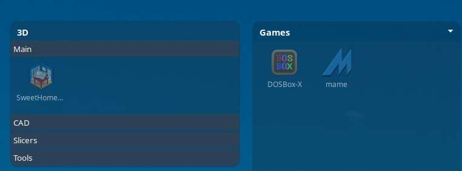
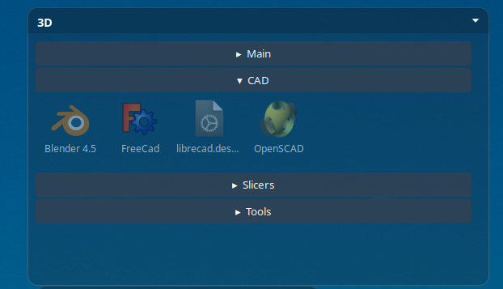
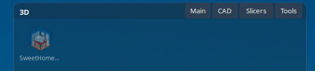
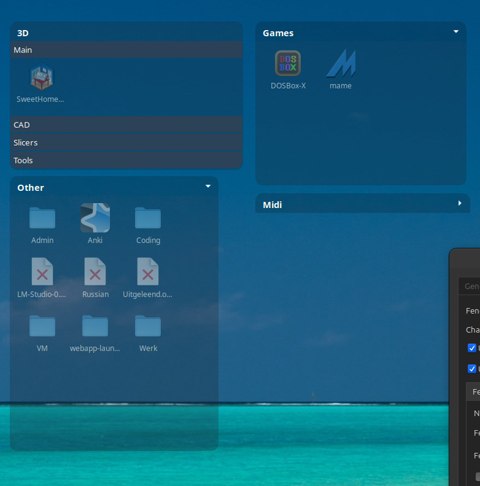
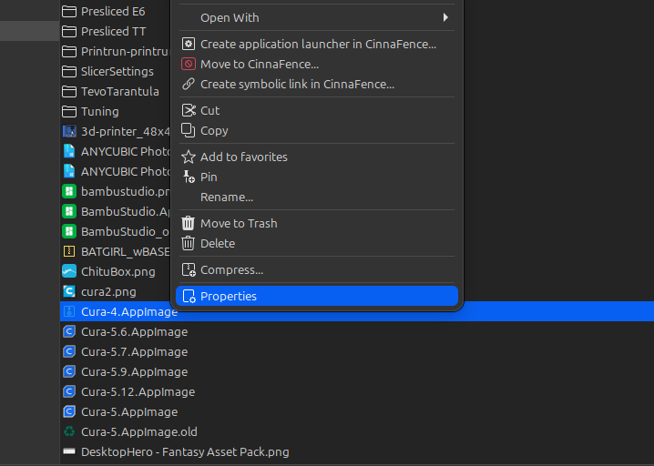
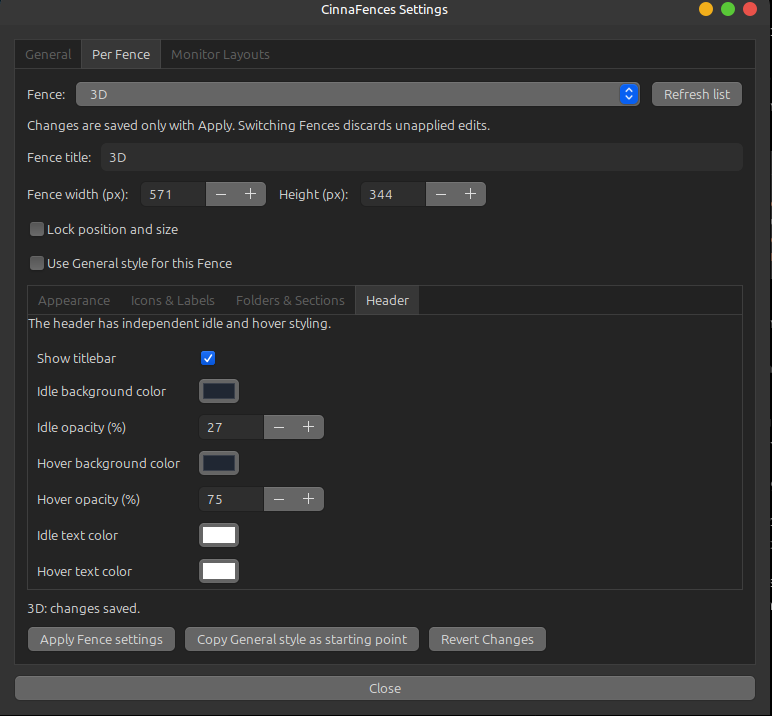
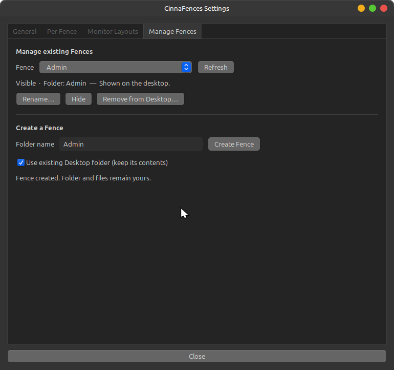

# CinnaFences

**Organize your Linux Mint Cinnamon desktop into customizable Fences — with tabs, expandable Rolodex sections, drag-and-drop, and Nemo integration.**

**Current version:** `0.5.18` · **Desktop:** Linux Mint / Cinnamon · **License:** MIT · **Status:** actively developed, tested on Cinnamon 6.6.9 (X11)



CinnaFences is a Cinnamon desktop extension that organizes real folders and files into movable, resizable desktop panels called **Fences**. It uses your existing `~/Desktop` folders, rather than moving everything into a proprietary database.

Choose a classic icon grid, a tabbed folder view, or a **Rolodex** in which each direct subfolder is represented by an expandable section. Customize individual Fences or use common style defaults.

> **Project scope:** CinnaFences is a community project, not an official Linux Mint or Cinnamon component. It has been developed and tested primarily on a Linux Mint Cinnamon 6.6.9 **X11** desktop. Other Cinnamon versions and Wayland have not been verified.

## Screenshots

### Rolodex: one open folder section at a time



Click a section heading to expand it. Opening another section closes the previous one; clicking the active section collapses it. Optional **auto-fit height** keeps a fully collapsed Rolodex compact and lets it grow when you open a section.

### Tabs: folders in the titlebar



Each tab represents a real direct subfolder. Tabs can appear in the content area or, when enough width is available, on the right side of the titlebar.

### Multiple Fences and loose desktop items



The optional **Desktop / Unassigned** Fence (renamed **Other** in this screenshot) shows files and ordinary folders located directly in `~/Desktop`, while excluding directories already managed by CinnaFences. It does not move those files simply by displaying them.

### Nemo context menu integration



Move files into a Fence, create symbolic links, or build a `.desktop` launcher using Cinnamon Desktop Editor. Selected AppImages or programs can prefill the launcher's name and command.

### Appearance and Fence management

| Per-Fence appearance | Manage Fences |
|:--:|:--:|
|  |  |

*Screenshots were captured during development; labels and layout may differ slightly in the current release.*

## Features

- **Three views per Fence:** Icons, Tabs and Rolodex, backed by real Desktop directories.
- **Drag-and-drop:** arrange icons within a section; move selected files between Fences, tabs and Rolodex sections; use Ctrl while dropping to copy supported files.
- **Multi-selection and Undo:** select multiple icons, undo the most recent supported transfer, and restore earlier icon arrangements.
- **Unassigned desktop items:** optionally show files and ordinary folders that are not assigned to a Fence.
- **Fence management:** create a Fence from a new or existing Desktop directory; rename its displayed title; hide, show, deactivate and reactivate without deleting the directory.
- **Context menus:** Rename, Move to Trash, Sort by Name, Compact Icons, view switching, collapse/expand and other actions.
- **Extensive styling:** separate idle/hover background opacity, header and section colors, text styling, icon/label settings, corner radius, and optional borders with configurable color, thickness and opacity.
- **Layout controls:** move, resize, lock, optionally snap to screen edges/other Fences/a grid, and temporarily bypass snapping using Alt.
- **Global show/hide:** optional configurable hotkey (`Super+F` is suggested but is disabled by default).
- **Monitor layouts:** manually save/restore Fence positions for a specific monitor setup, with Undo for the last restore.
- **Nemo integration:** move to Fence, create symbolic links and create application launchers via the existing Cinnamon Desktop Editor.
- **Native file layout:** the files remain regular files and folders. Removing a Fence from the desktop does **not** delete its contents.

## Requirements

- **Linux Mint Cinnamon**, tested on Cinnamon **6.6.9 / X11**.
- **Nemo** for file manager integration.
- Standard Linux Mint Cinnamon dependencies, including **GJS**, **Python 3** and the GTK 3 Python bindings used by the settings interface.
- No background daemon, no Node.js requirement for end users, and no `sudo` for installation in your home directory.

## Installation

Download the matching **`CinnaFences-0.5.18.zip` release package** and extract it into `~/Downloads`. The download package should contain the `CinnaFences-0.5.18/` directory with `upgrade.sh` inside it.

1. If upgrading, disable **CinnaFences** under **System Settings → Extensions** and close the CinnaFences settings window.
2. Open a terminal and run:

   ```bash
   cd ~/Downloads
   unzip CinnaFences-0.5.18.zip
   cd CinnaFences-0.5.18
   bash upgrade.sh
   ```

3. Enable **CinnaFences** under **System Settings → Extensions**.

The install script puts the Cinnamon extension in:

```text
~/.local/share/cinnamon/extensions/cinnafences@local/
```

It also installs the CinnaFences Nemo actions and a launcher for the settings window. If a previous extension was installed, the script saves a backup under `~/.local/share/cinnafences-backups/`.

**Upgrading does not move your Desktop files or overwrite your existing per-Fence configurations.**

If Nemo's new context menu entries do not appear right away, reopen Nemo.

### Installing from a source checkout

If you have checked out the complete repository, run `bash install.sh` from its root directory. You still need to enable the extension in Cinnamon's Extensions settings.

## Getting started

### 1. Create or activate a Fence

Open **CinnaFences Settings → Manage Fences**. Enter a name and create a new Desktop folder, or select **Use existing Desktop folder** to turn an existing folder such as `~/Desktop/3D` into a Fence. Existing files are retained.

### 2. Choose a display mode

Open **Per Fence**, select your Fence and choose its folder view under **Folders & Sections**:

| Mode | Behavior |
|---|---|
| **Icons** | Traditional icon layout for a folder. |
| **Tabs** | Direct subfolders are selectable tabs. |
| **Rolodex** | Subfolders become expandable headings; at most one is open. |

For example:

```text
~/Desktop/
└── 3D/
    ├── .cinnafence.json
    ├── CAD/
    │   ├── FreeCAD.desktop
    │   └── Blender.desktop
    ├── Slicers/
    │   ├── Cura.desktop
    │   └── Repetier.desktop
    └── Tools/
```

Here **CAD**, **Slicers** and **Tools** become tabs or Rolodex sections. Files stored directly in `3D/` appear under **Main**.

### 3. Customize and organize

Use **General** for shared defaults and **Per Fence** for individual styles and behavior. Fences can independently inherit general Appearance & Icons settings and/or general Header & Sections styling.

For a compact Rolodex, enable **Auto-fit height** under **Folders & Sections**. In headerless mode, move a Fence with **Alt + left-drag**.

### 4. Optionally enable Desktop / Unassigned

Under **General → Desktop**, enable the option to show loose desktop items. This virtual Fence lists ordinary contents of `~/Desktop` without moving them. You can rename the visible title to something like **Other**, and customize the Fence under **Per Fence**.

If you choose to hide regular Nemo desktop icons, CinnaFences provides a way to restore the original Nemo desktop layout in **General → Desktop**.

## Working with files

- **Move or copy:** drag between supported Fence destinations. Hold **Ctrl** while dropping to copy supported files. Filename collisions are refused rather than overwritten.
- **Rename:** right-click an icon and choose **Rename**. This renames the actual file or symbolic link (not its target).
- **Remove:** choose **Move to Trash** to make the file recoverable from Nemo's Trash.
- **Nemo shortcuts:** right-click a file in Nemo to create a **symbolic link** or **application launcher** in a chosen Fence or section.
- **Launchers:** `.desktop` files contain a command, name and optional icon; for AppImages the full original executable path is referenced.

**Note:** Drag-and-drop *directly between a Nemo window and a Fence* is not yet implemented. Use the provided Nemo context-menu actions instead.

## Configuration and safety

CinnaFences deliberately keeps user data in standard filesystem locations:

| Location | Purpose |
|---|---|
| `~/Desktop/<folder>/` | Actual content of an ordinary Fence. |
| `~/Desktop/<folder>/.cinnafence.json` | Settings and icon positions for that Fence. |
| `~/.config/cinnafences/` | General settings, virtual Unassigned settings and saved monitor layouts. |
| `~/.local/share/cinnamon/extensions/cinnafences@local/` | Installed extension code. |
| `~/.local/share/cinnafences-backups/` | Backups of previous extension installations. |

**Removing/deactivating a Fence only affects its desktop display; it does not delete the original directory or its files.** Moving an actual file to another Fence does change its filesystem location. Check destinations before using drag-and-drop, especially for launchers whose commands rely on an existing path.

## Troubleshooting

**A new Fence is missing from Desktop / Unassigned:** That is intentional: managed Fence directories are excluded from Unassigned. The new Fence should appear separately. If the UI does not update, disable/re-enable the extension and check **Manage Fences**.

**A `.desktop` launcher opens nothing:** Ensure its `Exec` command points to a valid executable. A command such as `/usr/bin/true` finishes immediately without opening a window; it is useful only as a basic launcher-creation test.

**Nemo context actions are missing:** Reopen Nemo, and verify that the Nemo actions were installed from the full release package.

**A window becomes unclickable over a Fence:** Report the Cinnamon version, session type (X11 or Wayland), and the CinnaFences version. The input-region handling has been explicitly adapted for Cinnamon 6.6.9/X11.

## Developer notes

The repository includes tests under `tests/`. The end-user application does **not** require Node.js; some optional JavaScript developer tests use Node.js if it is available.

```bash
bash tests/run-tests.sh
```

The project currently targets Cinnamon rather than GNOME Shell or other desktop environments.

## License

Licensed under the [MIT License](LICENSE).
